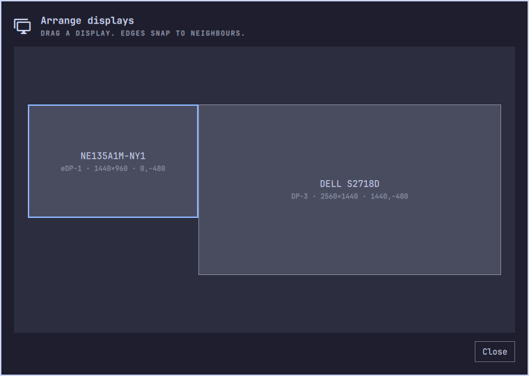

# Advanced Displays

Full monitor control for Omarchy. Resolution, arrangement, refresh rate, scale, rotation, mirroring, VRR, HDR and brightness, per display.

<p align="center">
  
  
</p>

## Install

```bash
omarchy plugin add https://github.com/Fluffet/omarchy-advanced-displays --enable
omarchy plugin disable omarchy.monitor
```

The second line hides the built-in Display widget, so you don't get two icons.

That's it. Click the new icon in your bar.

## Two things to know

**Changes apply live, but revert after 15 seconds.** Press **Keep** to save.

**Keep writes to `~/.config/hypr/monitors.lua`.** 

Settings are stored per monitor, not per port. Move the cable, settings follow.

## Rebind SUPER + CTRL + D

That key opened the built-in panel, which is now off. Point it here instead, in `~/.config/hypr/bindings.lua`:

```lua
hl.unbind("SUPER + CTRL + D")
o.bind("SUPER + CTRL + D", "Display", "omarchy-shell io.github.fluffet.display toggle")
o.bind("SUPER + CTRL + SHIFT + D", "Arrange displays", "omarchy-shell shell toggle io.github.fluffet.display")
```

## Uninstall

```bash
omarchy plugin remove io.github.fluffet.display
```

Press **Forget saved layout** first if you also want your monitor settings gone. Otherwise the block in `monitors.lua` stays.

<details>
<summary>Small print</summary>

- HDR only appears if the monitor's EDID says it supports it.
- VRR shows the EDID refresh range as a hint.
- Brightness uses the backlight on laptops, DDC on desktop monitors.
- Move the widget like any other: `omarchy bar move io.github.fluffet.display --section right`

</details>

<details>
<summary>Scripting (IPC)</summary>

```bash
omarchy-shell io.github.fluffet.display toggle
omarchy-shell io.github.fluffet.display state
omarchy-shell io.github.fluffet.display select DP-3
omarchy-shell io.github.fluffet.display change '{"hz":60}'   # keys: width height hz scale transform mirror vrr hdr disabled
omarchy-shell io.github.fluffet.display keep
omarchy-shell io.github.fluffet.display revert
omarchy-shell io.github.fluffet.display forget
```

</details>

<details>
<summary>Hacking on it</summary>

```bash
ln -s "$PWD" ~/.config/omarchy/plugins/io.github.fluffet.display
omarchy plugin enable io.github.fluffet.display
node --test test/model.test.js
bash test/monitors-lua.test.sh
shellcheck monitors-lua.sh
qmllint -I "$OMARCHY_PATH/shell" Panel.qml
```

Hot reload through a symlinked plugin dir is unreliable. `omarchy restart shell` always works.

</details>
