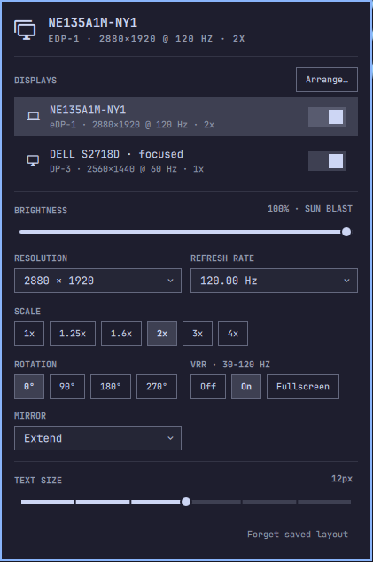

# Advanced Display for Omarchy

Bar widget and panel that replaces the built-in Display panel with full per-monitor configuration.




- Pick a display in the list. Everything below edits that one.
- Resolution, refresh rate, scale, rotation, mirror, VRR, HDR, brightness (backlight or DDC).
- Arrange… button when more than one display is on. Opens a window where you drag displays.
  Edges snap to neighbours and gaps close, so the cursor can always cross.
- HDR only shows when the monitor's EDID advertises it. VRR shows the EDID refresh range as a hint.
- Every change is applied live. Keep it within 15 seconds or it reverts!
- Keep writes the whole layout into a managed block at the end of `~/.config/hypr/monitors.lua`,
  keyed by `desc:` so settings follow the monitor, not the port.
- "Forget saved layout" removes the block and reloads Hyprland.

## Install

```bash
omarchy plugin add https://github.com/Fluffet/omarchy-advanced-display --enable
```

This adds the widget to your bar. Disable the built-in Display widget so you do not get two icons:

```bash
omarchy plugin disable omarchy.monitor
```

The built-in panel's key, SUPER+CTRL+D, then points at nothing. Rebind it in `~/.config/hypr/bindings.lua`:

```lua
hl.unbind("SUPER + CTRL + D")
o.bind("SUPER + CTRL + D", "Display", "omarchy-shell io.github.fluffet.display toggle")
o.bind("SUPER + CTRL + SHIFT + D", "Arrange displays", "omarchy-shell shell toggle io.github.fluffet.display")
```

Move it like any other widget:

```bash
omarchy bar move io.github.fluffet.display --section right
```

## Remove

```bash
omarchy plugin remove io.github.fluffet.display
```

This removes the widget only. The managed block in `~/.config/hypr/monitors.lua` stays until you press
"Forget saved layout" before removing, or delete the block by hand.

## IPC

```bash
omarchy-shell io.github.fluffet.display toggle
omarchy-shell io.github.fluffet.display state
omarchy-shell io.github.fluffet.display select DP-3
omarchy-shell io.github.fluffet.display change '{"hz":60}'   # keys: width height hz scale transform mirror vrr hdr disabled
omarchy-shell io.github.fluffet.display keep
omarchy-shell io.github.fluffet.display revert
omarchy-shell io.github.fluffet.display forget
```

## Develop

```bash
ln -s "$PWD" ~/.config/omarchy/plugins/io.github.fluffet.display
omarchy plugin enable io.github.fluffet.display
node --test test/model.test.js
bash test/monitors-lua.test.sh
shellcheck monitors-lua.sh
qmllint -I "$OMARCHY_PATH/shell" Panel.qml
```

Hot reload through a symlinked plugin dir is unreliable. `omarchy restart shell` always works.
